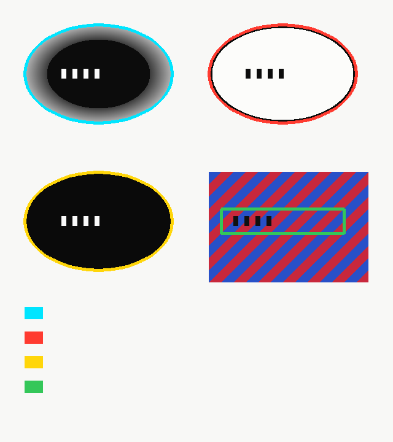

# panel-bridge


Read publisher webcomics you already have access to, in English, when the official English release is behind or missing — a client-side extension that finds the speech bubbles on the page you opened. **v0.1 detects and outlines bubbles only; it does not translate yet** (translation is milestone M3, see Roadmap).




**Why it matters:** Official English translations lag, and this helps you read the page you already opened, without rehosting or bypassing anything.

Each color is one detected bubble type; the detector's job at M1 is to find and label the speech balloons on a chapter cut, before OCR and translation touch it. Detection is partial today — measured accuracy is in **How detection is graded** below.

## Quickstart

```bash
npm install          # also downloads a Chromium for the demo
npm test             # 11 tests, synthetic fixtures only, no browser needed
npm run demo:m1      # opens Earth Game ch.1 on Naver, outlines the bubbles it detects
```

The demo launches its own headless Chromium. Set `M1_CDP=http://127.0.0.1:<port>` to attach to a Chrome you already run instead. Proof sheets and a counts table land in the gitignored `work/` — publisher images never enter git. Full walkthrough: [m1/README.md](m1/README.md).

## The four bubble types

| Type | Color | Meaning |
| --- | --- | --- |
| 1 | cyan `#00E5FF` | black bubble, rough / gradient-faded edge |
| 2 | red `#FF3B30` | white bubble, black text |
| 3 | yellow `#FFD60A` | black bubble, white text |
| 4 | green `#34C759` | text painted on the art, no bubble |

## How detection is graded

Two layers, no invented numbers:

1. **Unit tests** (`npm test`) — synthetic, procedurally drawn fixtures only (`m1/detect.test.ts`, `marker/bubbles.test.ts`): each of the four types must be marked, and negatives (a solid shadow, a white balloon when testing black, loose text) must not be.
2. **Live-page trials** (`m1/detector-trials/`) — the detector's per-cut counts on the real Earth Game ch.1 (134 cuts) are recorded in [docs/m1-ch1-results.md](docs/m1-ch1-results.md) and compared against an OpenCV MSER baseline run in Docker ([docs/m1-detector-trials.md](docs/m1-detector-trials.md)). A detection only counts as progress when it beats the baseline on the thing M1 actually requires: bubble-level outlines with a type, not text fragments.

### Measured accuracy (2026-10-13, Earth Game ch.1)

Hand-counted ground truth on 20 chapter cuts (40 translatable regions) vs. what the detector found, using count-based matching (a region counts once; extra detections on the same region are false positives):

| Region kind | True | Found | Recall | Notes |
| --- | --- | --- | --- | --- |
| Classic speech balloons (white / black) | 21 | 17 | **71%** | Misses are white balloons on a white page and dark balloons on dark art (thin outline lost at the 420px downscale). |
| System / caption panels (coloured UI boxes) | 9 | 0 | **0%** | Not modelled — the detector shreds them into several type-4 fragments instead of one box. |
| Narration / text painted on the art (type 4) | 10 | 0 | **0%** | The type-4 pass requires a *colourful* neighbourhood, so it skips text on black-and-white or dark art (this chapter is largely monochrome). |
| **Overall** | **40** | **57** | **recall 38%, precision 26%** | 40 of the 57 detections are type-4 fragments on busy art, most of them false. |

Bottom line: v0.1 reliably outlines classic speech balloons on full-colour pages, and is not yet usable as a general "find all the text" detector. Fixing the type-4 pass (drop the colour gate, merge fragments, add a panel class) is the next step before OCR.

## Roadmap

- **M1 — detection** (this release, v0.1.0): find and outline speech balloons on a live Naver chapter, per type. Partial — classic balloons only (~71% recall, see Measured accuracy); narration and system panels are not yet handled.
- **M2 — OCR**: read the text inside each detected balloon (Hangul / Japanese / Chinese). Detector trials already narrowed the candidate models.
- **M3 — translation overlay**: batched, cached, in-place replacement on the page — the actual extension, behind the per-site adapter contract ([docs/adapter-contract.md](docs/adapter-contract.md)).

Planning lives in the public issue tree: epic [#1](https://github.com/krantikaridev/panel-bridge/issues/1) → feature [#2](https://github.com/krantikaridev/panel-bridge/issues/2) → stories #3–#7.

## Why this exists

Official English is the bottleneck, not the art. Naver Webtoon is wave 0; the next targets are the platforms below, chosen because their English catalogues lag, shrink, or never existed.

- Korean originals on Naver and Kakao update on a weekly cadence. English WEBTOON Fast Pass, Tappytoon, and the old Tapas / Kakao Webtoon storefronts trail that, and many series are never licensed.
- Kakao is shutting Tapas and Kakao Webtoon and folding the IP onto Korean KakaoPage by the end of 2026. The English door is closing; the Korean catalogue is not.
- Chinese manhua is the largest permanent hole. Bilibili Comics shut its international app in February 2024. Tencent Comics (ac.qq.com) has no English edition. Kuaikan's English slice on INKR is a rotating subset and is usually months behind.
- Japanese Jump flagships are often simulpub on Manga Plus and VIZ. The lag is in the rest of the catalogue: Jump+ series that drop mid-run, Rookie and one-shots without overseas consent, Magazine Pocket web originals, Tonari no Young Jump, and light-novel adaptations on KadoComi.

Seed titles: Hardcore Leveling Warrior / Earth Game, plus the series already followed by hand (One Piece, Hunter x Hunter, Berserk, Teenage Mercenary, and irregular Naver schedules).

## What it is

- A browser extension that runs on the publisher page the reader already opened.
- Text path: detect Hangul, Japanese, or Chinese in the DOM and replace it in place.
- Image path: speech bubbles are usually baked into images or canvas, so OCR plus translation is required. Cache by image hash so a chapter is not re-billed.
- Batching and a MutationObserver so infinite-scroll chapters do not translate the same panel twice.
- A source adapter per site. Naver is the MVP adapter. Everything else is a later adapter behind the same contract (`docs/adapter-contract.md`).

## What it is not

- Not a mirror, scraper farm, or chapter redistributor. Pages are not rehosted.
- Not a paywall bypass. If a chapter is locked, the extension does not unlock it.
- Not a replacement for simulpub. If Manga Plus or WEBTOON already has the chapter the same day, that is the preferred read.
- Not a commercial product; the code is MIT, the comics are not.

Copyright in the comics stays with the publishers and creators. The extension is designed to translate a page the user is already entitled to view, in the user's browser (translation is M3, not yet built). Rights, ToS, and login walls still have to be checked per adapter before that adapter is enabled.

## Source waves

Full notes, URLs, and why each one lags: [docs/SOURCES.md](docs/SOURCES.md).

| Wave | Sources | Why next |
| --- | --- | --- |
| 0, in progress | Naver Webtoon (`comic.naver.com`) | MVP demo (`m1/`) in this repo. Largest Korean free catalogue. English is a licensed slice plus Fast Pass. |
| 1 | KakaoPage, Kakao Webtoon | Naver's rival. English storefronts shutting down by end of 2026. Same-day Korean chapters, wait-or-pay. |
| 2 | Kuaikan, Tencent Comics (ac.qq), Bilibili Manhua | Biggest English hole. EN Bilibili app is gone. ac.qq has no English edition. |
| 3 | Shonen Jump+, Magazine Pocket, Tonari no Young Jump | Jump flagships are often simulpub. These cover the catalog gaps, Kodansha web originals, and Young Jump (One-Punch Man and company). |
| 4 | Lezhin KR, Ridibooks, Bomtoon, Sunday Webry, KadoComi, Pixiv Comic | Paid or niche catalogues where English is partial, late, or absent. |

Chapter notification (Idea 2 on the ticket) stays in scope, but it is a separate module: irregular schedules on Naver and these same sources, not a second product.

## Status

- 2026-10-08: vision repo opened. Source map and adapter contract landed.
- 2026-10-08 later: layer-1 marker committed under `marker/`. The live preview did not hold up; the detector logic survived and is now wrapped by `m1/`.
- 2026-10-10: **M1 bubble-detection demo** landed under `m1/` — `npm run demo:m1` opens Earth Game ch.1 on the live Naver reader, outlines every bubble in one of four type colors, and writes proof sheets + a counts table to the gitignored `work/`. Results + honest limits: [docs/m1-ch1-results.md](docs/m1-ch1-results.md); tool-first detector trials: [docs/m1-detector-trials.md](docs/m1-detector-trials.md).
- **v0.1.0**: M1 is the shipped milestone. The extension shell (M3) is still not in this repo.

## Layout

```
docs/SOURCES.md                         ranked target sources
docs/adapter-contract.md                interface later adapters share
docs/m1-ch1-results.md                  M1 live-run counts + honest limits
docs/m1-detector-trials.md              tool-first detector comparison (OpenCV baseline in Docker)
marker/                                 layer-1 detector and the preview page (not the extension)
m1/                                     M1 demo: capture -> detect -> outline -> counts (npm run demo:m1)
extension/                              still empty (M3)
```

## License

MIT. See [LICENSE](LICENSE).

The code is open source. The comics are not: copyright in every panel stays with its publishers and creators, and this repo commits no episode art — only code, synthetic fixtures, and the legend image above. Rights, ToS, and login walls still have to be checked per adapter before that adapter is enabled.
